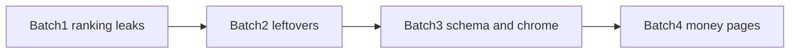

# Execute SEO audit fixes now

Source: the Sleek Car SEO audit. Address is already confirmed as **Milewskiego 10E**. Grant Prismic access (`sleekcar` repo) before the Prismic steps; code can start without it.

Out of scope until you hand over logins: Google Business Profile, mapfy/Orły citations, Search Console recrawl, `sleekcar.pl` domain.

## Review workflow

- **One branch** for the whole effort (for example `seo-audit-fixes`). No branch per step.
- **One git commit per interval** below, using the message as written.
- After each commit, **stop** so you can review the diff. Next interval starts only after you say continue.
- Prismic steps are not git commits. They still pause for review (screenshot / published URL).
- Deploy when you choose (after a commit, a batch, or the whole branch).

---

## Batch 1 — stop ranking leaks

### 1a. `fix(seo): keep already-absolute URLs intact in absoluteUrl`

[src/lib/seo.ts](../src/lib/seo.ts): if `path` already starts with `http`, return it unchanged. Stops [src/app/layout.tsx](../src/app/layout.tsx) `image: absoluteUrl(settings.defaultOgImage)` from emitting `https://sleek-car.pl/https://images.prismic.io/...`. Same helper is used for post/realization JSON-LD images.

**Review:** schema `image` is a single HTTPS URL.

### 1b. `fix(seo): use sleek-car.pl as fallback site URL`

[src/lib/content.ts](../src/lib/content.ts) `settings.siteUrl` is `https://sleekcar.pl` (hoodie shop). Change to `https://sleek-car.pl`.

**Review:** fallback canonical host is hyphenated.

### 1c. `fix(seo): redirect legacy service URLs to /oferta`

Redirects in [next.config.ts](../next.config.ts) (Netlify honors these via [netlify.toml](../netlify.toml)):

- `/folia-ppf` → `/oferta/folia-ochronna-ppf`
- `/korekta-lakieru` → `/oferta/renowacja-lakieru`
- `/przyciemnianie-szyb`, `/polerowanie-lamp`, `/przyciemnianie-lamp`, `/czyszczenie-wnetrza`, `/zabezpieczenie-lakieru`, `/usuwanie-wgniecen`, `/ozonowanie` → matching `/oferta/{slug}`

**Review (after deploy):** those old paths 301, they do not 404.

---

## Batch 2 — remove published leftovers

### 2a. `fix(copy): remove CMS leftover strings and restore Polish diacritics`

Hardcoded in [src/app/page.tsx](../src/app/page.tsx): Oferta “podstrony przygotowane pod SEO”, `#opinie` “Robocze cytaty…”, “Przejdz do kontaktu”. Also [src/components/CtaBand.tsx](../src/components/CtaBand.tsx) `zabezpieczyc` / `Najdokladniejsza`.

**Review:** homepage and CTA read as customer copy, with correct Polish.

### 2b. `fix(seo): noindex placeholder vlog posts and drop them from the sitemap`

[src/app/sitemap.ts](../src/app/sitemap.ts) and [src/app/aktualnosci/[slug]/page.tsx](../src/app/aktualnosci/[slug]/page.tsx): placeholder posts (empty `videoUrl` and body mentioning Prismic / “Miejsce na odcinek”) get `noindex` and are omitted from the sitemap.

**Review:** `/aktualnosci/vlog-kulisy-aplikacji-folii-ppf` is noindex and absent from `/sitemap.xml`.

### 2c. Prismic (no git commit)

Unpublish `vlog-kulisy-aplikacji-folii-ppf` until a real video exists. Overwrite any leftover CMS fields that still match the audit.

**Review:** URL 404s or is unpublished in Prismic.

---

## Batch 3 — metadata, schema, privacy

### 3a. `feat(seo): add email, geo, and catchment cities to LocalBusiness schema`

[src/app/layout.tsx](../src/app/layout.tsx): add `email`, expand `areaServed` (Turek, Konin, Koło, Kalisz, Uniejów), add `geo` for Milewskiego 10E. Do **not** add `aggregateRating`.

**Review:** JSON-LD on the homepage includes those fields only.

### 3b. `feat(seo): emit FAQPage JSON-LD on service pages`

[src/app/oferta/[slug]/page.tsx](../src/app/oferta/[slug]/page.tsx): emit `FAQPage` from existing `service.faqs`.

**Review:** a service page source contains FAQ JSON-LD matching the visible Q&A.

### 3c. `feat(seo): use seo_title, article Open Graph type, and a fuller kontakt title`

- Map unused `seo_title` in [src/lib/prismic-content.ts](../src/lib/prismic-content.ts)
- [src/lib/seo.ts](../src/lib/seo.ts): allow `og:type` `article` for posts/realizations
- Kontakt fallback `seoTitle: "Kontakt"` → `Kontakt, dojazd i wycena | Sleek Car Turek` (same string later in Prismic `contact_page`)

**Review:** kontakt tab title is longer; a blog/realization `og:type` is `article`.

### 3d. `fix(cms): load Prismic preview toolbar only in draft mode`

Gate `<PrismicPreview />` in [src/app/layout.tsx](../src/app/layout.tsx) with Next `draftMode()`.

**Review:** production HTML has no Prismic toolbar iframe.

### 3e. `fix(seo): add app icon for missing favicon`

Add `src/app/icon.png`. Favicon currently 404s.

**Review:** `/favicon.ico` or `/icon` returns 200.

### 3f. `feat(legal): add privacy policy page and footer link`

Static `/polityka-prywatnosci` plus footer link in [src/components/Footer.tsx](../src/components/Footer.tsx) (contact form + Maps + future analytics). No GA/GTM in this pass.

**Review:** footer link works; page is indexable.

---

## Batch 4 — make money pages rankable

### 4a. `feat(seo): render long-form body copy on service pages`

Service template today is one `asText` lead plus identical H2s. Add/render a `body` StructuredText field (or Prismic rich text) on [src/app/oferta/[slug]/page.tsx](../src/app/oferta/[slug]/page.tsx) so pages can be 700+ words.

**Review:** service template shows extra copy below the lead when the field is filled.

### 4b. `feat(seo): show related services and realization service links`

`related_services` exists on the service custom type but is not mapped. Map it in [src/lib/prismic-content.ts](../src/lib/prismic-content.ts) and render it. On realizations, link `services` relationships.

**Review:** a service page lists related services; a realization links to the matching offer.

### 4c. Prismic (no git commit)

Expand `folia-ochronna-ppf`, `zabezpieczenie-lakieru`, `renowacja-lakieru`, `przyciemnianie-szyb`: unique copy, catchment towns, packages/price ranges, links to matching realizations and `folia-ppf-czy-powloka-ochronna`.

**Review:** those four URLs are substantially longer and distinct from each other.
