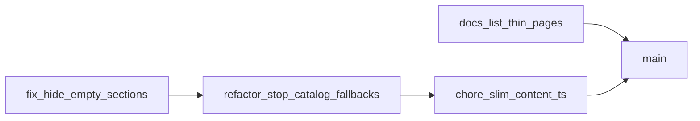

# Shrink `content.ts` in four MRs

`sleekcar.pl` (no hyphen) is **not** the studio domain. Do not own, redirect, or cite it. Keep using `https://sleek-car.pl` only.

One **branch + MR per step**, prefix from conventional commits (`docs` / `fix` / `refactor` / `chore`). One commit per branch. Target `main`. Merge **2 → 3 → 4** in that order (1 can land anytime). Stack 3 on 2 and 4 on 3 so each MR stays reviewable without waiting.

Do **not** write or publish long CMS copy for the thin URLs in this pass.

## MR 1 — `docs/list-remaining-thin-pages`

Commit: `docs: list remaining thin service, realization, and blog URLs`

Add [`docs/seo-thin-pages.md`](seo-thin-pages.md) in the repo (reviewable on the MR; not a store-only note).

**Already expanded (skip):**
- `/oferta/folia-ochronna-ppf`
- `/oferta/zabezpieczenie-lakieru`
- `/oferta/renowacja-lakieru`
- `/oferta/przyciemnianie-szyb`

**Still thin — 10 other services:**
- `/oferta/czyszczenie-wnetrza`
- `/oferta/przyciemnianie-lamp`
- `/oferta/usuwanie-wgniecen`
- `/oferta/polerowanie-lamp`
- `/oferta/usuwanie-zarysowan`
- `/oferta/bezpieczne-mycie-pojazdu`
- `/oferta/przygotowanie-pojazdu-do-sprzedazy`
- `/oferta/door-to-door`
- `/oferta/wypozyczenie-miernika-lakieru`
- `/oferta/ozonowanie`

**Still thin — 6 realizations:**
- `/realizacje/bmw-m3-touring-ppf`
- `/realizacje/porsche-911-turbo-s-ppf`
- `/realizacje/lamborghini-detailing-wnetrza`
- `/realizacje/audi-rs6-korekta-lakieru`
- `/realizacje/bmw-x5-ppf`
- `/realizacje/cupra-leon-st-detailing`

**Still thin — 2 real blog posts** (vlog already 404, omit):
- `/aktualnosci/folia-ppf-czy-powloka-ochronna`
- `/aktualnosci/jak-przygotowac-nowe-auto-do-pierwszych-kilometrow`

State that “thin” means short template copy (lead + repeated H2s), and that expanding them is a later Prismic writing pass.

## MR 2 — `fix/hide-empty-detail-sections`

Commit: `fix(ui): hide empty service and detail content sections`

Independent of the catalog shrink; land **before** MR 3 so empty CMS fields do not print blank “Dlaczego warto?” headings.

- [`src/app/oferta/[slug]/page.tsx`](../src/app/oferta/[slug]/page.tsx): render benefits / process / pricing / FAQ blocks only when those arrays have items. `body` is already gated.
- Same pattern on realization and post templates if they always render empty body/gallery headings.

No mapper or `content.ts` catalog changes in this MR.

## MR 3 — `refactor/stop-content-catalog-fallbacks`

Commit: `refactor(cms): stop filling empty Prismic fields from content catalogs`

This is the behavior change. Leave the catalogs in [`src/lib/content.ts`](../src/lib/content.ts) unused so MR 4 is a clean deletion diff.

In [`src/lib/prismic-content.ts`](../src/lib/prismic-content.ts):
- Map documents **without** per-slug catalog fallbacks. Empty field → empty string / empty array.
- Empty Prismic collections → **empty list**, not `fallbackServices` / `fallbackPosts`.
- `getService` / `getRealization` / `getPost`: missing UID → `undefined` → existing `notFound()`.
- Keep **settings** fallbacks (phone, Milewskiego 10E, `https://sleek-car.pl`).
- Image fallback: generic `settings.defaultOgImage` (or skip render), not `fallbackServices[0].heroImage`.
- Keep short singleton page chrome (`fallbackHome`, oferta/realizacje/news/kontakt titles) when a singleton fetch fails — not a second document catalog.

After this MR is deployed (preview is enough): check the four expanded services still have title, lead, images, benefits, process, faqs, and body. If a section vanished, fill that field in Prismic or rely on MR 2’s hidden empty blocks. Do **not** restore the catalogs.

## MR 4 — `chore/slim-content-ts`

Commit: `chore: slim content.ts to types and chrome defaults`

Safe only after MR 3: catalogs are dead code.

Keep in [`src/lib/content.ts`](../src/lib/content.ts):
- Types: `Service`, `Realization`, `Post`, `ImageAsset`, `FaqItem`
- `settings` (`siteUrl: "https://sleek-car.pl"`), `navItems`
- `isPlaceholderPost` (or move it next to post mapping in MR 3 and delete it here)
- CtaBand already has its own Polish default props in [`src/components/CtaBand.tsx`](../src/components/CtaBand.tsx)

Delete:
- `services`, `realizations`, `posts`, `testimonials`, `certifications` catalogs
- Unused helpers `getService` / `getRealization` / `getPost` / `getFeaturedServices`

Update [`docs/prismic-content-model.md`](prismic-content-model.md) so it no longer says the site is driven by `content.ts`.

## Out of scope

- GBP, citations, Search Console
- Writing long copy for the thin URLs
- GA4 / cookie banner
- Anything to do with `sleekcar.pl`
